# Quantitative TEM with deep learning

## Latest quantitative metrology release (October 2026)

**New: calibrated, five-fold localization, lattice and strain benchmarks.** The updated numerical exports evaluate **6,143 eligible frames** for Poisson-dose localization and **8,947 eligible frames** for lattice/strain reconstruction, all using held-out checkpoints. **Raw-input atomic-column repeatability is 0.89–1.03 pm at simulated count scale D=1000** across seven configurations; direct AtomSegNet identifies a lattice in **98.1%** of eligible frames (**99.5%** correct cell conditional on recovery), with median calibrated cell errors **+0.082% (xx), +0.071% (yy)** and local strain RMS errors **0.917% (xx), 1.002% (yy), 0.696% (xy)** against exact simulated atoms. Precision remains above a matched Poisson CRLB, and local strain errors are close to their localization-derived reference floor.

**[Read the complete new release, original run exports, seven-model CSV tables and updated figures →](results/2026-10-quantitative-metrology/README.md)**

[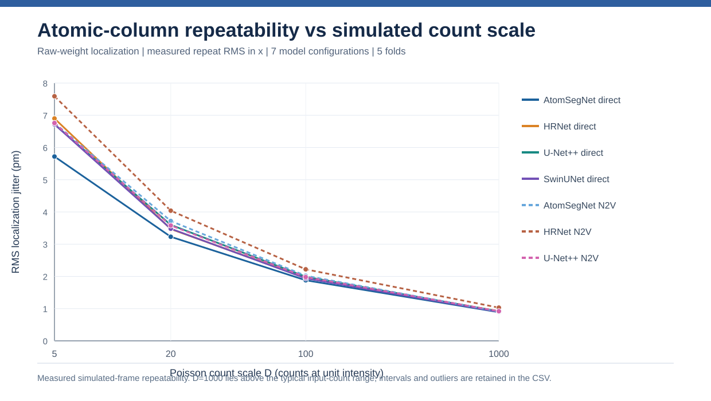](results/2026-10-quantitative-metrology/README.md)

[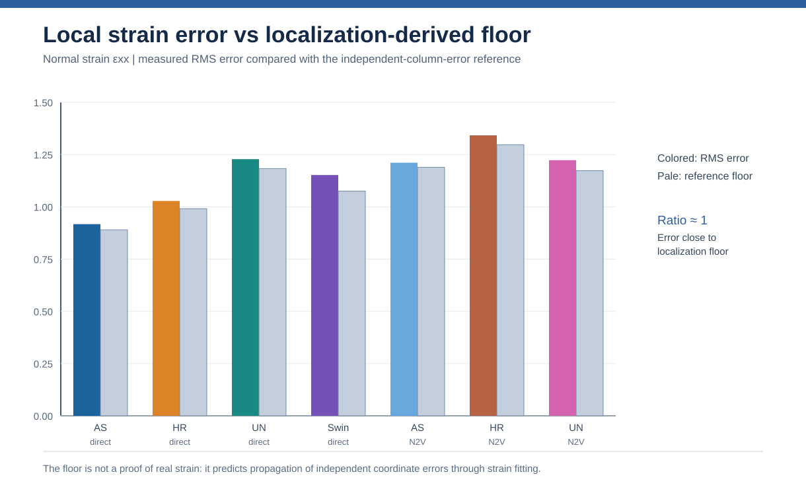](results/2026-10-quantitative-metrology/README.md)

> **Interpretation:** These are simulations with known atomic models, not experimental ground-truth strain measurements. `D` denotes simulated counts at unit intensity (not a calibrated e⁻/Ų electron dose). The reported sub-pm value is **repeatability**, not absolute position accuracy. The earlier figures, benchmark subsets and training metrics below are retained as historical baselines rather than silently replaced.

---

Denoising, atomic-column segmentation, sub-pixel localization and lattice diagnostics on simulated HAADF-TEM, measured under one protocol.

We compare four dual-head networks of matched size (~9.1 M parameters each) on 14,364 paired 256 × 256 frames from TEM-ImageNet-v1.3. Each model takes a noisy simulated frame and returns a denoised image and an atomic-column probability map. The question is whether a model that reconstructs the image better also measures the lattice better. It does not: across five folds, direct SwinUNet gave the only denoising result above the Gaussian reference (30.82 dB), while direct AtomSegNet gave the highest segmentation IoU (0.8763). Image fidelity and coordinate quality are therefore reported as separate measurements throughout this repository, and no single score is formed from them.

The five-fold summary is in [`tables/benchmark_summary.csv`](tables/benchmark_summary.csv). A complete single-fold diagnostic run in [`runs/20260919-200658/`](runs/20260919-200658/) adds coordinate accuracy, controlled shifts, a perturbation grid and device timings, and [`runs/atomap_benchmark_v3/`](runs/atomap_benchmark_v3/README.md) compares the networks against classical Atomap peak fitting.

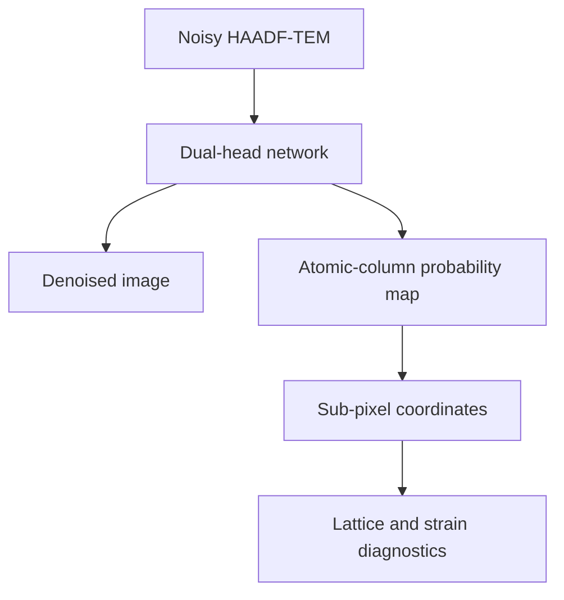

## Protocol

Five folds were generated with `KFold(n_splits=5, shuffle=True, random_state=42)` over the sorted paired basenames, and each fold was evaluated on a deterministic 600-image subset of its validation split (3,000 evaluations per configuration). Segmentation was scored against `circularMask` at a probability threshold of 0.5. Denoising was scored against `noNoise` and referenced to a Gaussian filter ($\sigma = 1$) recomputed on the same inputs within each fold. Coordinates were matched to peaks taken from `gaussianMask`. AtomSegNet, U-Net++ and HRNet were each trained directly and after a self-supervised Noise2Void (N2V) warm start; SwinUNet has direct folds only. Metric definitions are in [`docs/methods.md`](docs/methods.md).

## Segmentation and denoising

| Condition | Model | Parameters (M) | IoU at 0.5 | Dice | PSNR (dB) | SSIM | $\Delta$ PSNR vs Gaussian (dB) |
|---|---|---:|---:|---:|---:|---:|---:|
| Direct | AtomSegNet | 9.121 | 0.8763 ± 0.0026 | 0.9330 | 24.68 ± 0.73 | 0.706 | -1.93 |
| Direct | HRNet | 9.181 | 0.8629 ± 0.0019 | 0.9249 | 26.45 ± 0.34 | 0.801 | -0.16 |
| Direct | U-Net++ | 9.118 | 0.8601 ± 0.0071 | 0.9236 | 18.13 ± 8.14 | 0.615 | -8.48 |
| Direct | SwinUNet | 9.272 | 0.8547 ± 0.0041 | 0.9199 | 30.82 ± 0.35 | 0.917 | +4.21 |
| N2V warm start | AtomSegNet | 9.121 | 0.8616 ± 0.0018 | 0.9244 | 20.98 ± 0.45 | 0.587 | -5.63 |
| N2V warm start | HRNet | 9.181 | 0.8248 ± 0.0064 | 0.9009 | 15.82 ± 0.78 | 0.445 | -10.79 |
| N2V warm start | U-Net++ | 9.118 | 0.8604 ± 0.0101 | 0.9236 | 15.17 ± 6.59 | 0.527 | -11.43 |

Values are means over five folds ± sample standard deviation.

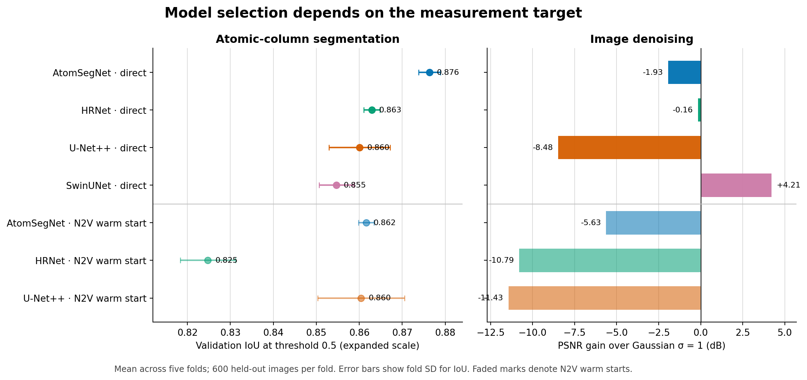

Direct AtomSegNet led on IoU in every fold: by 0.0134 over HRNet (95% CI 0.0123 to 0.0145), 0.0162 over U-Net++ (CI 0.0126 to 0.0209) and 0.0216 over SwinUNet (CI 0.0182 to 0.0250). Because the four direct models span only 0.0216 in IoU, architecture affects segmentation much less than input corruption does: supplying the clean frame on fold 2 raised AtomSegNet from 0.8537 to 0.9013, and removing the simulated background took it to 0.9190 ([`tables/input_ablation.csv`](tables/input_ablation.csv)).

Denoising separates the models much further. Direct SwinUNet gained 4.21 dB over the Gaussian reference (SSIM 0.917) with a five-fold spread of 0.35 dB. Every CNN denoising head sat at or below the Gaussian reference. U-Net++ was the least stable configuration, with a fold spread of 8.14 dB direct and 6.59 dB after the warm start.

Each strip below shows one held-out frame from that model's best fold: noisy input, clean target, reconstruction, reference mask, predicted probability, and an error overlay (green: correct, red: false positive, yellow: missed atom).


<details>
<summary>Strips for the other six configurations</summary>

Each model is shown on a different frame, so per-frame IoU values are not comparable across strips.

**Direct**


**Noise2Void warm start**


</details>

## Noise2Void warm start

Self-supervised pre-training on the noisy images without labels reduced IoU for two of the three CNNs and left the third unchanged across the five folds.

| Model | Mean $\Delta$ IoU | Folds won by N2V | Paired $p$ | Mean $\Delta$ PSNR (dB) |
|---|---:|---:|---:|---:|
| AtomSegNet | -0.0147 | 0/5 | 4.9 × 10⁻⁶ | -3.70 |
| U-Net++ | +0.0003 | 3/5 | 0.945 | -2.95 |
| HRNet | -0.0382 | 0/5 | 6.0 × 10⁻⁵ | -10.63 |

The warm start also shifted coordinates: on fold 2, the mean bias magnitude of AtomSegNet rose from 0.360 px (direct) to 0.702 px (N2V), increasing the bias share of total error from 0.074 to 0.196. All 21 paired contrasts are in [`runs/20260919-200658/tables/paired_differences.csv`](runs/20260919-200658/tables/paired_differences.csv) and [`docs/model-comparison.md`](docs/model-comparison.md).

## Cost

Timings are medians at batch size 1 on an RTX 3070 Ti Laptop GPU, fold 2.

| Direct model | GMACs | Latency (ms) | Throughput at batch 8 (img/s) | VRAM at batch 1 (MB) | IoU per GMAC |
|---|---:|---:|---:|---:|---:|
| SwinUNet | 2.82 | 20.37 | 263 | 116 | 0.303 |
| AtomSegNet | 18.01 | 12.23 | 163 | 177 | 0.049 |
| U-Net++ | 34.98 | 32.16 | 59 | 288 | 0.025 |
| HRNet | 106.14 | 49.26 | 12 | 641 | 0.008 |

Compute spans a factor of 37.7 across the four models and buys 0.0216 of IoU. HRNet requires 5.9× the GMACs, 4× the latency and 3.6× the memory of AtomSegNet, and segments 0.0134 worse. SwinUNet has the fewest GMACs because attention runs on merged patches, but is slower than AtomSegNet at batch size 1 where kernel launches dominate latency.

## Architectures

All four models emit a denoised image and an atomic-column map, differing in how spatial information is routed:

* **AtomSegNet:** Five-level residual U-Net with attention-gated skip connections.
* **U-Net++ (`MT-UNet++`):** Nested dense skip pathways with four deep-supervision branches.
* **HRNet:** Three parallel spatial resolutions with repeated cross-resolution fusion.
* **SwinUNet:** Hierarchical shifted-window transformer with patch merging and expansion (patch size 4, window size 8, embedding width 56, depths 2-2-2-2, heads 2-4-8-16).

<details>
<summary>Architecture schematics</summary>

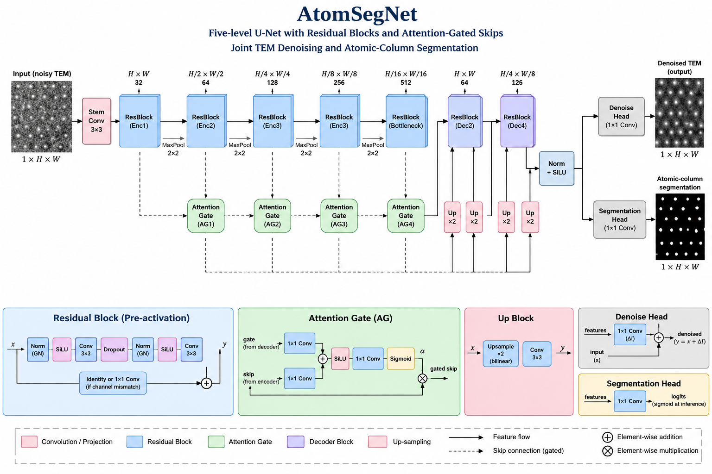
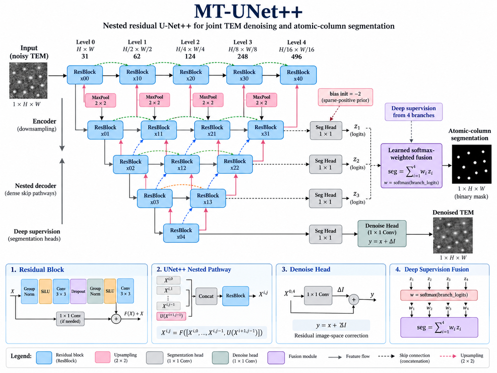
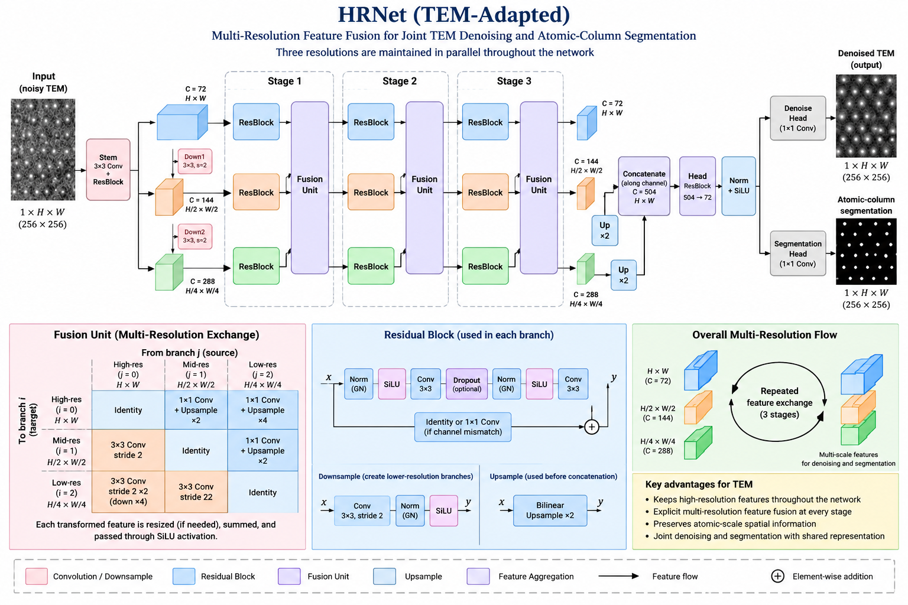
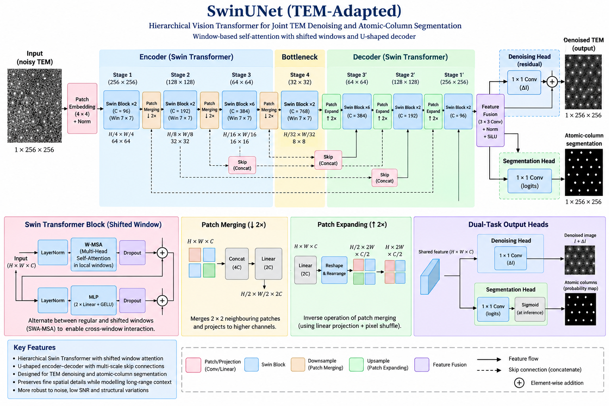

</details>

## From masks to calibrated atomic coordinates (October 2026 update)

The earlier segmentation benchmark established that **segmentation overlap and reconstruction quality are different objectives**: direct AtomSegNet led fixed-threshold segmentation (five-fold mean IoU **0.8763**), whereas direct SwinUNet led reconstruction (**30.82 dB PSNR**, **+4.21 dB** relative to the Gaussian reference). Neither metric alone proves quantitative coordinate accuracy. We therefore added a **larger, calibrated sub-pixel localization analysis against simulated atomic-model coordinates**, rather than treating the older 40-frame single-fold peak test as the definitive result.

The updated Poisson benchmark covers **6,143 eligible held-out simulated frames from 5,744 atomic structures** over **five folds and seven training configurations**, at four controlled count scales **D = 5, 20, 100, 1000**. Every scored frame is evaluated by a checkpoint that did not train on it, with additional atomic-structure overlap exclusions. Peak fitting on the **raw noisy frame** is compared separately with fitting on the **network's reconstructed/denoised image**. The N2V label refers to **training warm start**, not the image source used for localization.

### Calibrated sub-pixel bias and pixel locking

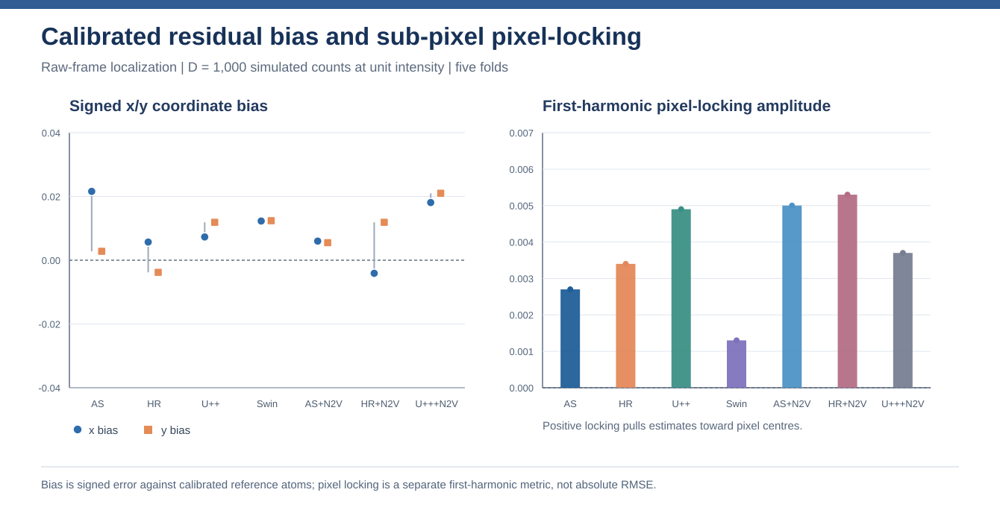

**Residual signed coordinate bias is distinct from pixel locking:** for direct AtomSegNet fitted on the raw frame at D=1000, x/y bias is **(+0.0216, +0.0028) px** against exact atomic positions on the calibrated image grid; first-harmonic x locking is **+0.0027 px**. Across all seven raw-frame configurations at this count scale, measured x pixel locking is **+0.0013 to +0.0053 px**. Positive locking denotes attraction toward pixel centres. These summary values do *not* reconstruct the historical phase-by-phase shift-response curve.

### What happens when the fitted input is denoised?

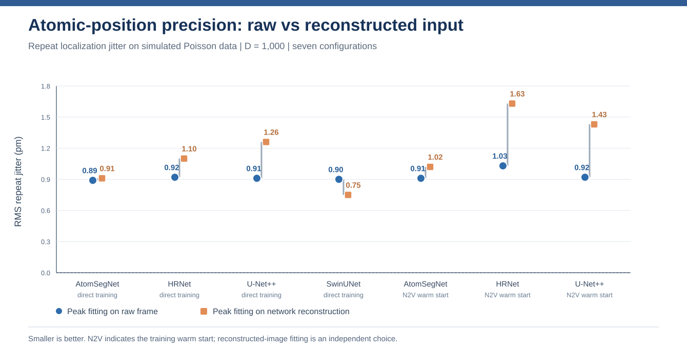

| Training configuration | Raw-frame jitter (pm) | Reconstructed-frame jitter (pm) | Raw x locking (px) | Raw jitter / Poisson CRLB |
|---|---:|---:|---:|---:|
| AtomSegNet direct | **0.89** | 0.91 | +0.0027 | **1.83** |
| HRNet direct | 0.92 | 1.10 | +0.0034 | 1.98 |
| U-Net++ direct | 0.91 | 1.26 | +0.0049 | 1.93 |
| SwinUNet direct | 0.90 | **0.75** | +0.0013 | 1.90 |
| AtomSegNet + N2V warm start | 0.91 | 1.02 | +0.0050 | 1.91 |
| HRNet + N2V warm start | 1.03 | 1.63 | +0.0053 | 2.41 |
| U-Net++ + N2V warm start | 0.92 | 1.43 | +0.0037 | 1.99 |

Here **D = 1000 is a simulated count scale at unit intensity**, **not** a calibrated electron dose in e⁻/Ų; it lies above the median/noisy-frame count range of the input dataset (**median D = 18.7; 5th–95th percentile 2.5–60.6**). The displayed picometre results are **repeatability** (RMS variation of repeat estimates), **not absolute localization accuracy**. At D=1000, raw-coordinate outlier rates remain **8.46–9.61%** and raw-weight precision is **1.83–2.41×** the matched Poisson CRLB. Small residual locking therefore does not mean the estimator has reached its information limit.

Unlike the single-fold historical result, this multi-model comparison demonstrates that denoised-input peak fitting is **not uniformly beneficial**: direct SwinUNet improves from **0.90 to 0.75 pm** when using its reconstruction, but direct U-Net++ degrades from **0.91 to 1.26 pm**. Model-specific image reconstruction and coordinate precision must be evaluated separately.


**[Full October run documentation, original logs, 56-row metric table and matched-CRLB figure](results/2026-10-quantitative-metrology/README.md)**

<details>
<summary>Archived September 2026 single-fold localization and shift diagnostics (historical; not the current headline)</summary>

This earlier test evaluated **40 frames from fold 2**; local maxima were matched to `gaussianMask` reference peaks within a 3 px gate. It used a different reference, population and calibration convention from the October benchmark, so the RMSE values below are **not directly comparable** with the October repeat jitter in pm.

| Direct model | Detection F1 | Matched RMSE (px) | Bias magnitude (px) | Latency (ms) |
|---|---:|---:|---:|---:|
| AtomSegNet | 0.9476 | 1.322 | 0.360 | 12.23 |
| U-Net++ | 0.9308 | 1.392 | 0.405 | 32.16 |
| SwinUNet | 0.9174 | 1.377 | 0.302 | 20.37 |
| HRNet | 0.9067 | 1.405 | 0.347 | 49.26 |

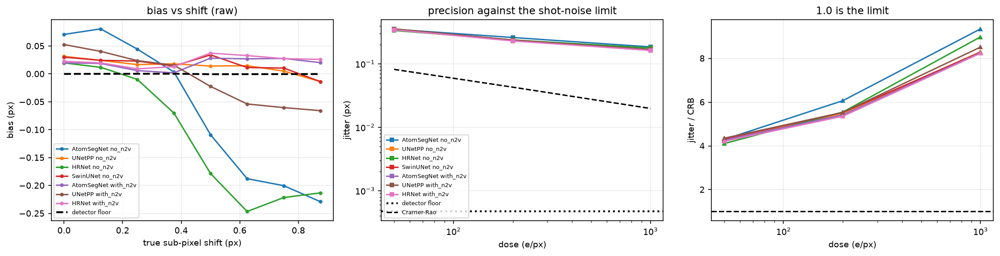

In that archived controlled-shift experiment (0–0.875 px applied and compensated afterward), direct AtomSegNet at simulated D=1000 showed **0.273 px median residual RMSE** when fitting on the raw image and **0.410 px** on its reconstruction. Noise-free detector shift error was **0.017 px** ([archived detector floor](tables/detector_floor.csv)). These describe the **September setup**; they are not updated five-fold values.

An archived 5,040-evaluation perturbation grid (20 stems × four D levels × three blur values × three tilt values) showed a direct AtomSegNet IoU range of 0.8856–0.8770 over the highest/lowest levels and direct SwinUNet 0.8891–0.8589. See [original single-fold run](runs/20260919-200658/).

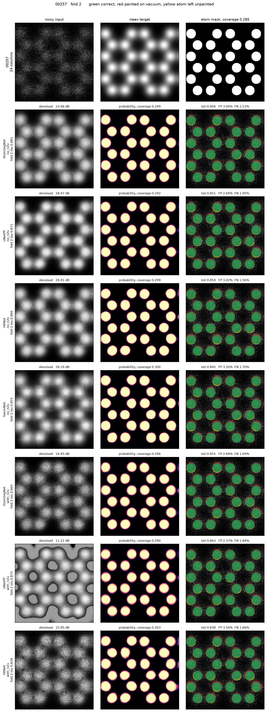

</details>

## Atomap comparison

A separate benchmark ([`runs/atomap_benchmark_v3/`](runs/atomap_benchmark_v3/README.md)) compares classical Atomap peak fitting with the three CNN segmenters on 50 common fold-2 frames against `gaussianMask` peaks, using uncalibrated raw coordinates, a 0.10 × spacing detection gate and a 0.25 × spacing localization gate.

| Method | Precision | Recall | F1 | Matched RMSE (px) | Localization coverage |
|---|---:|---:|---:|---:|---:|
| Atomap / noisy input | 0.185 | 0.409 | 0.255 | 2.155 | 55.6% |
| Atomap / noise-free control | 0.921 | 0.557 | 0.695 | 0.978 | 56.8% |
| Atomap / noise- and background-free control | 0.947 | 0.501 | 0.656 | 0.581 | 50.7% |
| AtomSegNet / direct | 0.801 | 0.900 | 0.847 | 1.187 | 99.6% |
| HRNet / direct | 0.803 | 0.900 | 0.849 | 1.237 | 99.2% |
| U-Net++ / direct | 0.801 | 0.896 | 0.846 | 1.247 | 99.2% |
| AtomSegNet / N2V | 0.762 | 0.850 | 0.804 | 1.339 | 98.3% |
| HRNet / N2V | 0.755 | 0.844 | 0.797 | 1.375 | 97.7% |
| U-Net++ / N2V | 0.806 | 0.904 | 0.852 | 1.239 | 99.1% |

On noisy input, Atomap reaches F1 0.255 (RMSE 2.155 px) compared with 0.846–0.849 (RMSE 1.187–1.247 px) for the directly trained CNNs. RMSE is conditioned on gated matches, whereas F1 penalizes missed and spurious columns. This is a single-fold comparison on raw coordinates without translation calibration or verified picometre scaling; see [`runs/atomap_benchmark_v3/README.md`](runs/atomap_benchmark_v3/README.md) for scope caveats.

## Lattice and strain diagnostics

Detected centers are fitted to a reference lattice and the residual displacement field is propagated to local estimates of $\varepsilon_{xx}$, $\varepsilon_{yy}$, $\varepsilon_{xy}$ and rotation over 60 dense frames per configuration. Because the manifest pixel scale (0.1229 Å/px) is unverified, coordinate errors are quoted in pixels. On unlabeled experimental frames, the direct models reached consensus coverage of 0.468 to 0.501 with 83–89% of FFT lattice reflections preserved ([`results/transfer_by_arch.csv`](results/transfer_by_arch.csv)).

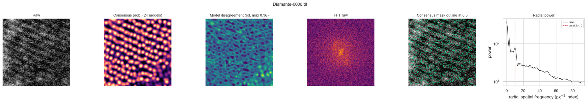

## Repository layout

| Path | Contents |
|---|---|
| [`notebooks/01_cnn_training_pipeline.ipynb`](notebooks/01_cnn_training_pipeline.ipynb) | AtomSegNet, U-Net++ and HRNet training and evaluation |
| [`notebooks/02_swinunet_training.ipynb`](notebooks/02_swinunet_training.ipynb) | SwinUNet training record, five direct folds |
| [`notebooks/03_benchmark_and_physics.ipynb`](notebooks/03_benchmark_and_physics.ipynb) | Four-model benchmark and downstream physics analyses |
| [`tables/`](tables/) | Benchmark summary, centroid metrics, input ablation, detector floor and checkpoint inventory |
| [`runs/20260919-200658/`](runs/20260919-200658/) | Archived single-fold diagnostic run (tables, figures, panels, manifest and logs) |
| [`runs/atomap_benchmark_v3/`](runs/atomap_benchmark_v3/) | Atomap peak-fitting baseline comparison |
| [`assets/`](assets/) | Comparison figures, architecture schematics, qualitative strips and strain/transfer examples |
| [`results/`](results/) | Earlier per-fold localization, precision, strain and transfer output |
| [`docs/`](docs/) | [`methods.md`](docs/methods.md), [`model-comparison.md`](docs/model-comparison.md), [`reproducibility.md`](docs/reproducibility.md), [`supplementary-results.md`](docs/supplementary-results.md) and [`portfolio-blurb.md`](docs/portfolio-blurb.md) |
| [`scripts/`](scripts/) | `check_dataset.py`, `plot_model_comparison.py` and `summarize_supplementary_run.py` |

## Reproduction

Committed tables and figures can be inspected without the dataset or weights:

```bash
git clone [https://github.com/akatsuki2bb/tem-atomic-localization-strain.git](https://github.com/akatsuki2bb/tem-atomic-localization-strain.git)
cd tem-atomic-localization-strain

python -m venv .venv
source .venv/bin/activate        # Windows: .venv\Scripts\activate
pip install -r requirements.txt

python scripts/plot_model_comparison.py        # regenerates the comparison figure
python scripts/summarize_supplementary_run.py  # checks row counts, recomputes medians
```

Notebook execution requires `TEM-ImageNet-v1.3` and the 35 trained checkpoints (paths configured via [`.env.example`](.env.example)):

```bash
export TEM_PROJECT_ROOT="$PWD"
export TEM_DATA_ROOT="/path/to/TEM-ImageNet-v1.3"
export TEM_RESULTS_ROOT="/path/to/checkpoints-and-run-records"
export TEM_REAL_DATA="/path/to/experimental-tifs"       # optional

python scripts/check_dataset.py
jupyter lab notebooks/03_benchmark_and_physics.ipynb
```

Run environment: Windows 11, Python 3.14.2, PyTorch 2.11.0+cu128 and NumPy 2.5.1 on an RTX 3070 Ti Laptop GPU ([`environment.yml`](environment.yml), [`docs/reproducibility.md`](docs/reproducibility.md)).

## Citation

Upadhyay, U. Quantitative TEM with deep learning: a five-fold comparison of denoising, atomic-column segmentation and coordinate recovery on simulated HAADF-TEM. 2026. https://github.com/akatsuki2bb/tem-atomic-localization-strain
