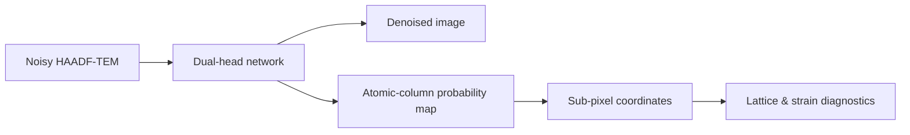

# Quantitative TEM with Deep Learning

**Denoising, atomic-column segmentation, sub-pixel localization, and lattice diagnostics on simulated HAADF-TEM, measured under a single unified protocol.**

[Protocol](#protocol) • [Segmentation & Denoising](#segmentation-and-denoising) • [N2V Warm Start](#noise2void-warm-start) • [Compute Cost](#computational-cost) • [Localization & Perturbations](#from-masks-to-coordinates) • [Atomap Benchmark](#atomap-comparison-october-2026-benchmark) • [Reproduction](#reproduction)

---

We compare four dual-head networks of matched capacity (~9.1M parameters each) across 14,364 paired 256 × 256 frames from `TEM-ImageNet-v1.3`. Each model takes a noisy simulated HAADF-TEM frame and predicts both a denoised image and an atomic-column probability map. 

The central question is whether a network that reconstructs pixel intensity better also measures the atomic lattice better. **It does not:**
* **Reconstruction vs. Segmentation:** Across five folds, direct **SwinUNet** produced the only denoising result above the Gaussian baseline (**30.82 dB** PSNR), whereas direct **AtomSegNet** achieved the highest segmentation accuracy (**0.8763** IoU) and downstream column detection (**0.9476** F1).
* **Self-Supervised Pre-Training:** A Noise2Void (N2V) warm start degraded or failed to improve supervised segmentation across all tested CNNs and Nearly doubled coordinate bias in AtomSegNet.
* **Denoising Before Peak Fitting:** Fitting coordinates on a model's denoised output increased sub-pixel residual RMSE compared to fitting directly on the raw frame.

Image fidelity and coordinate quality are therefore reported as separate measurements throughout this repository; no composite score is formed from them.

The headline five-fold comparison is stored in [`tables/benchmark_summary.csv`](tables/benchmark_summary.csv). A comprehensive single-fold diagnostic suite—covering coordinate accuracy, controlled sub-pixel shifts, dose/blur/tilt perturbation grids, and hardware timings—is archived in [`runs/20260919-200658/`](runs/20260919-200658/). A separate [Atomap v3 benchmark](runs/atomap_benchmark_v3/README.md) adds a classical peak-fitting baseline on 50 common fold-2 frames.



---

## Protocol

Five folds were generated with `KFold(n_splits=5, shuffle=True, random_state=42)` over sorted paired basenames. Each fold was evaluated on a deterministic 600-image subset of its validation split, yielding 3,000 evaluations per configuration:

* **Segmentation:** Scored against `circularMask` at a fixed probability threshold of `0.5`.
* **Denoising:** Scored against `noNoise` and referenced against a Gaussian filter ($\sigma = 1$) recomputed on the identical inputs within each fold.
* **Localization:** Matched to reference peaks extracted from `gaussianMask`.
* **Training Regimes:** AtomSegNet, U-Net++, and HRNet were trained both directly from scratch and following a self-supervised Noise2Void (N2V) warm start. SwinUNet was evaluated on direct folds only.

Full metric definitions and evaluation rules are documented in [`docs/methods.md`](docs/methods.md).

---

## Segmentation and Denoising

Values represent five-fold means ± sample standard deviation. Best results per column are highlighted in **bold**.

| Condition | Model | Params (M) | IoU @ 0.5 | Dice | PSNR (dB) | SSIM | $\Delta$ PSNR vs. Gaussian (dB) |
|---|---|---:|---:|---:|---:|---:|---:|
| Direct | **AtomSegNet** | 9.121 | **0.8763 ± 0.0026** | **0.9330** | 24.68 ± 0.73 | 0.706 | -1.93 |
| Direct | **HRNet** | 9.181 | 0.8629 ± 0.0019 | 0.9249 | 26.45 ± 0.34 | 0.801 | -0.16 |
| Direct | **U-Net++** | 9.118 | 0.8601 ± 0.0071 | 0.9236 | 18.13 ± 8.14 | 0.615 | -8.48 |
| Direct | **SwinUNet** | 9.272 | 0.8547 ± 0.0041 | 0.9199 | **30.82 ± 0.35** | **0.917** | **+4.21** |
| N2V warm start | **AtomSegNet** | 9.121 | 0.8616 ± 0.0018 | 0.9244 | 20.98 ± 0.45 | 0.587 | -5.63 |
| N2V warm start | **HRNet** | 9.181 | 0.8248 ± 0.0064 | 0.9009 | 15.82 ± 0.78 | 0.445 | -10.79 |
| N2V warm start | **U-Net++** | 9.118 | 0.8604 ± 0.0101 | 0.9236 | 15.17 ± 6.59 | 0.527 | -11.43 |


### Key Observations

* **Segmentation:** Direct AtomSegNet led on IoU in every fold: by +0.0134 over HRNet (5/5 folds, 95% CI `[0.0123, 0.0145]`), +0.0162 over U-Net++ (5/5, CI `[0.0126, 0.0209]`), and +0.0216 over SwinUNet (5/5, CI `[0.0182, 0.0250]`). Because the four direct architectures span only 0.0216 in IoU, architectural choice has a much smaller effect on segmentation than input corruption: supplying the clean frame on fold 2 raised AtomSegNet IoU from 0.8537 to 0.9013, and removing the simulated background brought it to 0.9190 ([`tables/input_ablation.csv`](tables/input_ablation.csv)).
* **Denoising:** Denoising separates the architectures sharply. Direct SwinUNet beat the Gaussian baseline by **+4.21 dB** (SSIM 0.917) with tight cross-fold stability (±0.35 dB). Every CNN denoising head performed at or below the Gaussian reference and should not be used as a standalone denoiser in this configuration. U-Net++ exhibited severe cross-fold instability in reconstruction (±8.14 dB direct, ±6.59 dB with N2V).

### Qualitative Strips

Each strip below shows one held-out frame from that configuration's best fold: noisy input, clean target, model reconstruction, reference mask, predicted probability, and an error overlay (**green** = true positive, **red** = false positive / vacuum painted as atom, **yellow** = false negative / missed atom).


<details>
<summary><strong>View qualitative strips for the remaining six configurations</strong></summary>
<br>

*Note: Each configuration is shown on a representative frame from its own best fold; per-frame IoU values are not directly comparable across strips. Use the five-fold means above for model ranking.*

**Direct Training**


**Noise2Void Warm Start**


</details>

---

## Noise2Void Warm Start

The warm start consisted of self-supervised Noise2Void pre-training on the target noisy images without labels prior to supervised fine-tuning. Paired across the five folds, it reduced segmentation IoU for two of the three CNNs and left the third statistically unchanged:

| Model | Mean $\Delta$ IoU | Folds Won by N2V | Paired $p$-value | Mean $\Delta$ PSNR (dB) |
|---|---:|---:|---:|---:|
| **AtomSegNet** | -0.0147 | 0 / 5 | $4.9 \times 10^{-6}$ | -3.70 |
| **U-Net++** | +0.0003 | 3 / 5 | 0.945 | -2.95 |
| **HRNet** | -0.0382 | 0 / 5 | $6.0 \times 10^{-5}$ | -10.63 |

The $p$-values are derived from five paired fold observations and are treated as exploratory. Pre-training also degraded localization: on fold 2, direct AtomSegNet recorded a mean coordinate bias magnitude of **0.360 px**, which rose to **0.702 px** after the N2V warm start (increasing the bias share of total error from 7.4% to 19.6%). All 21 paired statistical contrasts are logged in [`runs/20260919-200658/tables/paired_differences.csv`](runs/20260919-200658/tables/paired_differences.csv), with detailed analysis in [`docs/model-comparison.md`](docs/model-comparison.md).

---

## Computational Cost

Timings represent medians at batch size 1 on an NVIDIA RTX 3070 Ti Laptop GPU (fold 2).

| Direct Model | GMACs | Latency (ms) | Throughput @ Batch 8 (img/s) | VRAM @ Batch 1 (MB) | IoU per GMAC |
|---|---:|---:|---:|---:|---:|
| **SwinUNet** | **2.82** | 20.37 | **263** | **116** | **0.303** |
| **AtomSegNet** | 18.01 | **12.23** | 163 | 177 | 0.049 |
| **U-Net++** | 34.98 | 32.16 | 59 | 288 | 0.025 |
| **HRNet** | 106.14 | 49.26 | 12 | 641 | 0.008 |

Compute spans a factor of **37.7×** across the four architectures while buying only **0.0216** in IoU. HRNet requires 5.9× the multiply-accumulates, 4.0× the latency, and 3.6× the memory of AtomSegNet, yet segments 0.0134 worse. SwinUNet requires the fewest GMACs because attention operates on merged patch tokens, but exhibits higher single-image latency than AtomSegNet (20.37 ms vs. 12.23 ms) where kernel launch overhead dominates arithmetic throughput.

---

## Architectures

All four networks share a dual-head topology (emitting a denoised frame and an atomic-column probability map) but differ in spatial feature routing:

* **AtomSegNet:** Five-level residual U-Net with attention-gated skip connections.
* **U-Net++ (`MT-UNet++`):** Nested dense skip pathways with four deep-supervision branches.
* **HRNet:** Three parallel spatial resolutions with repeated multi-resolution fusion.
* **SwinUNet:** Hierarchical shifted-window transformer with patch merging and expansion (patch size 4, window size 8, embedding width 56, depths `(2, 2, 2, 2)`, attention heads `(2, 4, 8, 16)`).

The schematics below are explanatory; the executable definitions in the training notebooks are the source of truth.

<details>
<summary><strong>AtomSegNet — Residual Attention U-Net</strong></summary>
<br>


</details>

<details>
<summary><strong>U-Net++ — Nested Skip Pathways & Deep Supervision</strong></summary>
<br>


*`MT-UNet++` is the schematic label for the dual-task `UNetPP` implementation in this repository.*

</details>

<details>
<summary><strong>HRNet — Parallel Multi-Resolution Fusion</strong></summary>
<br>


</details>

<details>
<summary><strong>SwinUNet — Hierarchical Shifted-Window Transformer</strong></summary>
<br>


*Direct SwinUNet trained for 60 epochs on each of the five folds, converging to PSNR 30.19–30.54 dB and peak F1 0.8917–0.8942 between epochs 57 and 60 ([`runs/20260919-200658/tables/training_curves_summary.csv`](runs/20260919-200658/tables/training_curves_summary.csv)).*

</details>

---

## From Masks to Coordinates

Local maxima of the predicted probability map are refined to sub-pixel centers and matched against reference peaks within a 3 px radius. The evaluation below covers 40 frames from fold 2:

| Direct Model | Detection F1 | Matched RMSE (px) | Bias Magnitude (px) | Latency (ms) |
|---|---:|---:|---:|---:|
| **AtomSegNet** | **0.9476** | **1.322** | 0.360 | **12.23** |
| **U-Net++** | 0.9308 | 1.392 | 0.405 | 32.16 |
| **SwinUNet** | 0.9174 | 1.377 | **0.302** | 20.37 |
| **HRNet** | 0.9067 | 1.405 | 0.347 | 49.26 |

Model ordering tracks segmentation IoU rather than denoising PSNR. Even though SwinUNet reconstructs image intensities 4.2 dB better than the baseline, it detects fewer atomic columns than AtomSegNet—though its matched coordinates show the lowest systematic bias (**0.302 px**).


### Sub-Pixel Shift & Perturbation Diagnostics

1. **Controlled Fractional Shifts:** Known translations between `0` and `0.875 px` were applied prior to inference and subtracted afterward across three frames, three electron doses, three noise realizations, and two coordinate sources. For direct AtomSegNet at dose 1000, median residual RMSE was **0.273 px** when fitting directly on the raw frame, compared to **0.410 px** when fitting on the network's own denoised output. On noise-free inputs, the peak detector recovers imposed shifts to within **0.017 px** across 24 diagnostic cases ([`tables/detector_floor.csv`](tables/detector_floor.csv)), confirming that the 0.27 px floor is set by input noise and network transformation—and that **denoising before coordinate fitting degrades precision**.
2. **Dose, Blur, and Tilt Perturbation Grid:** Across 5,040 evaluations (20 image stems × 4 doses `[20–1000]` × 3 blur levels × 3 tilt angles), direct AtomSegNet held IoU within **0.009** between the highest and lowest dose (0.8856 at dose 1000 vs. 0.8770 at dose 20). Direct SwinUNet dropped by **0.030** over the same interval (0.8891 to 0.8589), making the best image reconstructor the most dose-sensitive segmenter. Full tables and figures are in [`runs/20260919-200658/`](runs/20260919-200658/).


---

## Lattice and Strain Diagnostics

Detected column centers are fitted to a reference lattice, and the residual displacement field is differentiated to estimate local strain components ($\varepsilon_{xx}$, $\varepsilon_{yy}$, $\varepsilon_{xy}$) and lattice rotation across 60 dense frames per configuration (fold 2). Because the manifest pixel scale (`0.1229 Å/px`) is not independently verified against a physical calibration standard, coordinate errors are reported in pixels and strain maps are presented as geometric demonstrations.

On unlabeled experimental micrographs, out-of-distribution transfer is quantified via spatial coverage, inter-model consensus, and FFT Bragg reflection preservation. Direct models achieved a consensus coverage of **0.468–0.501** while preserving **83%–89%** of lattice reflections ([`results/transfer_by_arch.csv`](results/transfer_by_arch.csv)).


---

## Atomap Comparison: October 2026 Benchmark

A dedicated v3 localization benchmark compares classical 2D Gaussian peak fitting ([Atomap](https://atomap.org/)) against the trained CNN segmenters on **50 common fold-2 evaluation frames**, using `gaussianMask` peaks as the ground-truth reference, uncalibrated raw coordinates, a **0.10 × spacing detection gate**, and a **0.25 × spacing localization gate**.

| Method / Input Condition | Precision | Recall | F1 | Matched RMSE (px) | Localization Coverage |
|---|---:|---:|---:|---:|---:|
| **Atomap** (Noisy input) | 0.185 | 0.409 | 0.255 | 2.155 | 55.6% |
| **Atomap** (*Noise-free control*) | 0.921 | 0.557 | 0.695 | 0.978 | 56.8% |
| **Atomap** (*Noise- & background-free control*) | **0.947** | 0.501 | 0.656 | **0.581** | 50.7% |
| **AtomSegNet** (Direct) | 0.801 | 0.900 | 0.847 | 1.187 | **99.6%** |
| **HRNet** (Direct) | 0.803 | 0.900 | 0.849 | 1.237 | 99.2% |
| **U-Net++** (Direct) | 0.801 | 0.896 | 0.846 | 1.247 | 99.2% |
| **AtomSegNet** (N2V) | 0.762 | 0.850 | 0.804 | 1.339 | 98.3% |
| **HRNet** (N2V) | 0.755 | 0.844 | 0.797 | 1.375 | 97.7% |
| **U-Net++** (N2V) | 0.806 | **0.904** | **0.852** | 1.239 | 99.1% |

Under this protocol, Atomap on noisy inputs reaches F1 **0.255** and matched RMSE **2.155 px**, whereas directly trained CNNs reach F1 **0.846–0.849** and matched RMSE **1.187–1.247 px**. Note that these metrics measure different conditional quantities: matched RMSE is computed strictly over peaks passing the localization gate, whereas F1 penalizes missed and spurious columns. The noise-free Atomap rows are synthetic upper-bound controls, not experimentally accessible baselines.

> **Scope and Measurement Caveats:**
> * This is a single-fold, 50-frame study, not a replacement for the five-fold architectural ranking above.
> * Training/evaluation split membership was inherited from an earlier localization run and was not independently re-audited in the v3 manifest.
> * Translation calibration is available for the Atomap image controls but **not** for the neural network outputs; consequently, the table reports raw, uncalibrated coordinates across all methods.
> * Stored network peak conventions and continuous `position` label conventions (axis order, origin, scale) require independent verification before physical picometre conversion.
> * Frame-bootstrap intervals do not establish structural or acquisition independence. SwinUNet (evaluated on fold 4) was excluded due to fold mismatch.

See the [Atomap v3 benchmark documentation](runs/atomap_benchmark_v3/README.md) for full methodology and machine-readable tables.

---

## Repository Layout

| Path | Contents |
|---|---|
| [`notebooks/01_cnn_training_pipeline.ipynb`](notebooks/01_cnn_training_pipeline.ipynb) | AtomSegNet, U-Net++, and HRNet training and evaluation |
| [`notebooks/02_swinunet_training.ipynb`](notebooks/02_swinunet_training.ipynb) | SwinUNet training pipeline and logs (five direct folds) |
| [`notebooks/03_benchmark_and_physics.ipynb`](notebooks/03_benchmark_and_physics.ipynb) | Four-model benchmark and downstream lattice/strain analyses |
| [`tables/`](tables/) | Benchmark summaries, centroid metrics, input ablations, detector floor, and checkpoint inventories |
| [`runs/20260919-200658/`](runs/20260919-200658/) | Complete archived fold-2 diagnostic run (11 tables, 9 figures, 3 panels, manifest, and event log) |
| [`runs/atomap_benchmark_v3/`](runs/atomap_benchmark_v3/) | Classical peak-fitting comparison notes and summary tables |
| [`assets/`](assets/) | Model comparison plots, architecture schematics, and strain/transfer visualizations |
| [`assets/strips/`](assets/strips/) | Held-out qualitative evaluation strips for all seven configurations |
| [`results/`](results/) | Per-fold localization, sub-pixel precision, strain, and experimental transfer outputs |
| [`docs/methods.md`](docs/methods.md) | Formal metric definitions and the rationale against composite scoring |
| [`docs/model-comparison.md`](docs/model-comparison.md) | Paired fold statistics and scope notes for supporting tables |
| [`docs/reproducibility.md`](docs/reproducibility.md) | Hardware/software environment, checkpoint layout, and three-tier rerun guide |
| [`docs/supplementary-results.md`](docs/supplementary-results.md) | Detailed walkthrough of coordinate, perturbation, and latency benchmarks |
| [`docs/portfolio-blurb.md`](docs/portfolio-blurb.md) | Concise project summaries |
| [`scripts/`](scripts/) | `check_dataset.py`, `plot_model_comparison.py`, and `summarize_supplementary_run.py` |

---

## Reproduction

### 1. Inspect Committed Tables & Regenerate Figures (No Dataset or GPU Required)

All summary tables and benchmark plots can be verified directly from the committed CSV records:

```bash
git clone [https://github.com/akatsuki2bb/tem-atomic-localization-strain.git](https://github.com/akatsuki2bb/tem-atomic-localization-strain.git)
cd tem-atomic-localization-strain

python -m venv .venv
source .venv/bin/activate        # Windows: .venv\Scripts\activate
pip install -r requirements.txt

python scripts/plot_model_comparison.py        # Regenerates assets/model_comparison.png
python scripts/summarize_supplementary_run.py  # Audits row counts and recomputes medians
```

### 2. Full Notebook Execution (Requires Dataset & Checkpoints)

Running the evaluation and training notebooks requires `TEM-ImageNet-v1.3` and the 35 trained model checkpoints (stored externally). Configure your local paths via environment variables (see [`.env.example`](.env.example)):

```bash
export TEM_PROJECT_ROOT="$PWD"
export TEM_DATA_ROOT="/path/to/TEM-ImageNet-v1.3"
export TEM_RESULTS_ROOT="/path/to/checkpoints-and-run-records"
export TEM_REAL_DATA="/path/to/experimental-tifs"       # Optional: for transfer evaluation

python scripts/check_dataset.py
jupyter lab notebooks/03_benchmark_and_physics.ipynb
```

**Reference Environment:** Windows 11, Python 3.14.2, PyTorch 2.11.0+cu128, and NumPy 2.5.1 on an NVIDIA RTX 3070 Ti Laptop GPU. A Conda specification is provided in [`environment.yml`](environment.yml); see [`docs/reproducibility.md`](docs/reproducibility.md) and [`data/README.md`](data/README.md) for directory layout expectations.

---

## Citation

If you use these benchmarks, protocols, or code in your research, please cite:

> Upadhyay, U. *Quantitative TEM with deep learning: a five-fold comparison of denoising, atomic-column segmentation and coordinate recovery on simulated HAADF-TEM.* 2026. https://github.com/akatsuki2bb/tem-atomic-localization-strain

```bibtex
@misc{upadhyay2026quantitativetem,
  author       = {Upadhyay, U.},
  title        = {Quantitative {TEM} with deep learning: a five-fold comparison of denoising, atomic-column segmentation and coordinate recovery on simulated {HAADF-TEM}},
  year         = {2026},
  howpublished = {\url{[https://github.com/akatsuki2bb/tem-atomic-localization-strain](https://github.com/akatsuki2bb/tem-atomic-localization-strain)}}
}
```

Questions, replications, and corrections are welcome via the [issue tracker](https://github.com/akatsuki2bb/tem-atomic-localization-strain/issues).
