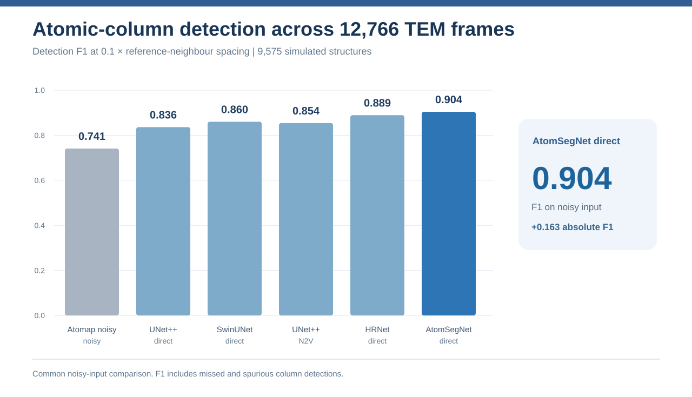
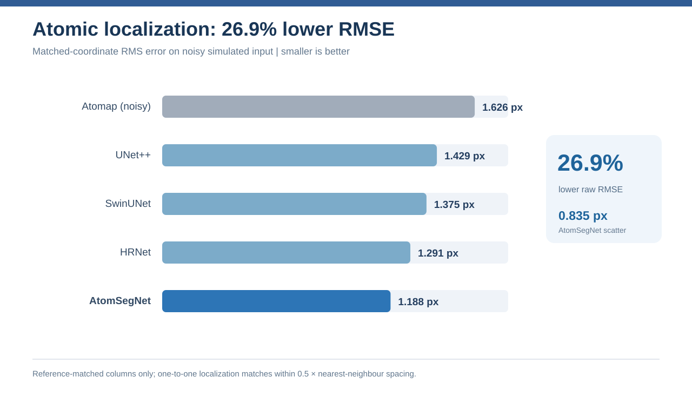
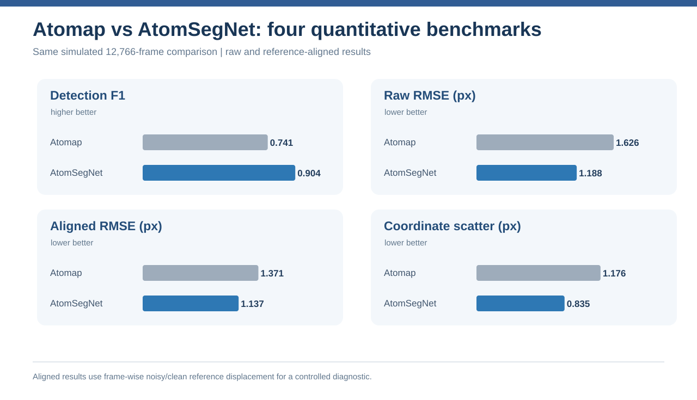
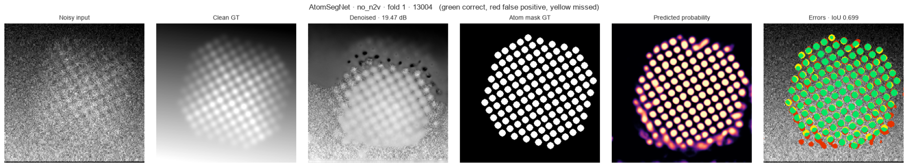

# Atomic-column localization: deep learning vs Atomap

**A 12,766-frame benchmark of atomic-column detection and coordinate recovery**

> **Headline:** On noisy simulated TEM images, direct **AtomSegNet reaches detection F1 = 0.904** versus **0.741 for Atomap**, with **26.9% lower matched-coordinate RMSE** (1.188 vs 1.626 px) and **29.0% lower coordinate scatter** (0.835 vs 1.176 px). The experiment spans **12,766 held-out frames from 9,575 simulated atomic structures**.

## What the benchmark demonstrates

Atomic-column localization is the bridge from neural segmentation to quantitative lattice measurements. The comparison evaluates **classical Atomap Gaussian peak fitting** [1] and several neural atomic-column localization configurations inspired by TEMImageNet/AtomSegNet [2] on a common simulated input population.

| Headline metric | Direct AtomSegNet | Atomap, noisy input | Result |
|---|---:|---:|---|
| Detection F1 (0.1 × neighbour spacing gate) | **0.904** | 0.741 | **+0.163 absolute F1** |
| Raw matched-coordinate RMSE | **1.188 px** | 1.626 px | **26.9% lower RMSE** |
| Matched-coordinate scatter | **0.835 px** | 1.176 px | **29.0% lower scatter** |
| Reference-aligned matched RMSE | **1.137 px** | 1.371 px | **17.1% lower RMSE** |

This is a **noisy-input** comparison. The archive also records a **clean-input Atomap reference control, F1 = 0.974 and raw RMSE = 0.840 px**, which is displayed separately because it answers a different question.

### Detection ranking, same noisy-input population

### Matched atomic-position accuracy

### Detection, precision and alignment in one comparison

## Full reported performance summary

The latest **reported** October comparison (source summary dated 17–19 October 2026) contains the following raw and reference-aligned statistics.

| Method | Input | Detection F1 | Raw RMSE (px) | Reference-aligned RMSE (px) |
|---|---|---:|---:|---:|
| **AtomSegNet, direct** | Noisy | **0.904** | **1.188** | **1.137** |
| HRNet, direct | Noisy | 0.889 | 1.291 | 1.226 |
| SwinUNet, direct | Noisy | 0.860 | 1.375 | 1.212 |
| U-Net++, direct | Noisy | 0.836 | 1.429 | 1.158 |
| U-Net++, N2V warm start | Noisy | 0.854 | 1.387 | 1.238 |
| AtomSegNet, N2V warm start | Noisy | 0.833 | 1.435 | 1.146 |
| HRNet, N2V warm start | Noisy | 0.820 | 1.521 | 1.282 |
| **Atomap** | **Noisy** | **0.741** | **1.626** | **1.371** |
| Atomap, clean-image control | Noiseless | 0.974 | 0.840 | Not reported |

Machine-readable benchmark summary: [`tables/summary_reported.csv`](tables/summary_reported.csv). Empty fields in that table indicate a metric was **not available in the supplied summary**, not zero. Full per-frame data and confidence-interval exports from this later run have not been deposited here, so confidence intervals are not invented.

## Atomic-column images

**Representative, genuine project output:** noisy synthetic atomic-resolution input, reference and neural-network atomic-column results, and detection overlay from this repository's existing model-output gallery. The graphic demonstrates the column-mapping workflow but **is not presented as a measured Atomap-versus-AtomSegNet overlay**.

A second historical processed-image panel:

The **numerical comparison above does come from the 12,766-frame Atomap evaluation**. Native side-by-side position overlays for the later Atomap run are not included in the older GitHub archive. They should be added as actual exported frame-level figures rather than synthesizing arbitrary atomic coordinates.

## Matched protocol and calibration

- **Evaluation:** 12,766 held-out simulated TEM frames, 9,575 atomic structures, assembled across five folds.
- **Detection:** pooled F1 with a gate of **0.10 × reference nearest-neighbour spacing**.
- **Localization:** one-to-one matched atomic columns within **0.50 × reference spacing**; report positional scatter and matched RMSE separately.
- **Reference targets:** exact simulated atom positions; Gaussian- and circular-mask definitions are additional coordinate-label analyses.
- **Frame displacement diagnostic:** 9,460 / 12,766 noisy/reference pairs (**74.1%**) have a displacement exceeding 0.5 px. Reference-assisted per-frame displacement alignment reduces Atomap's reported offset from **0.736 to 0.012 px**.
- **Alignment interpretation:** the **raw noisy-input comparison** is the primary performance claim. The aligned RMSE test shows what happens after known per-frame reference displacement is removed; this is a controlled diagnostic rather than a ready-to-deploy calibration procedure.

### Why it matters

The combination of higher detection F1, lower fitted-coordinate scatter, and lower matched-location RMSE makes deep-learning localization compelling for downstream **lattice indexing, displacement reconstruction and strain metrology**. For the newer calibrated full-dataset lattice/strain analysis, see the [October quantitative metrology release](../2026-10-quantitative-metrology/README.md).

## Citation and provenance

**[1] Classical Atomap method**

Nord, M., Vullum, P. E., MacLaren, I., Tybell, T., and Holmestad, R. (2017). *Atomap: a new software tool for the automated analysis of atomic resolution images using two-dimensional Gaussian fitting.* **Advanced Structural and Chemical Imaging, 3**, 9. https://doi.org/10.1186/s40679-017-0042-5

**[2] TEMImageNet and AtomSegNet**

Lin, R., Zhang, R., Wang, C., Yang, X.-Q., and Xin, H. L. (2021). *TEMImageNet training library and AtomSegNet deep-learning models for high-precision atom segmentation, localization, denoising, and deblurring of atomic-resolution images.* **Scientific Reports, 11**, 5386. https://doi.org/10.1038/s41598-021-84499-w

**Dataset/metric provenance:** The 12,766-frame figures above are transcribed from the October 2026 large-benchmark results reported in the associated project/manuscript discussion. They are **not recomputed from the archived 50-frame `atomap_benchmark_v3` data**, whose population, reference and matching gates differ. This directory keeps the large-run summary distinct from the earlier archival [50-frame Atomap experiment](../../runs/atomap_benchmark_v3/README.md).

**Reproducibility:** `../../scripts/plot_atomap_benchmark_2026.py` regenerates the performance visualizations from the committed CSV summary. To support a full new analysis or representative *paired* Atomap detection overlays, the later evaluation's frame-level atom coordinates, Atomap detections and model predictions must also be archived.
