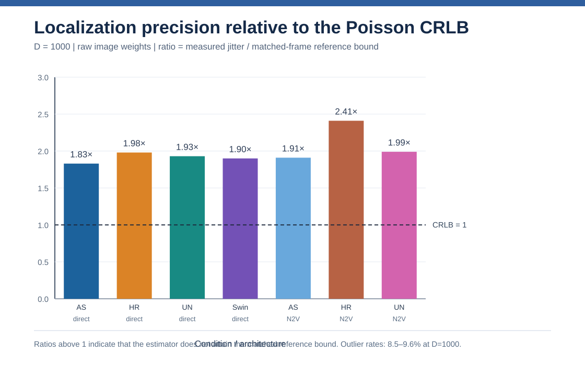
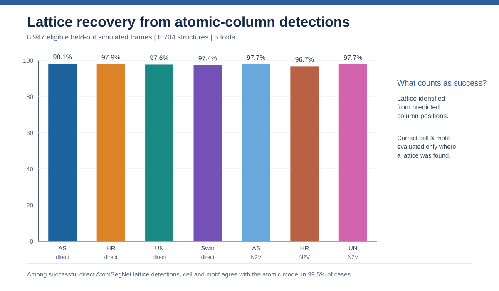

# October 2026 calibrated quantitative TEM metrology

**Status:** measured numerical exports from controlled **simulated** TEM/HAADF-TEM benchmarks. This release extends, and does not overwrite, the historical five-fold segmentation and September single-fold diagnostics.

## Read this first

| Test | Population | Key result |
|---|---|---|
| Poisson localization/repeatability | 6,143 eligible frames, 5,744 structures; seven model configurations × five folds | Raw-input localization repeat jitter at simulated **D=1000**: **0.89–1.03 pm**, depending on model |
| Matched Poisson CRLB | Same dose/frames as localization, matched to reference atomic columns | High-count measured jitter is **1.83–2.41×** the reference CRLB for raw-weight localization |
| Lattice identification | 8,947 eligible frames, 6,704 structures | **96.7–98.1%** lattice recovery across the seven configurations |
| Absolute cell measurement | Eligible lattice reconstructions, image-grid calibration applied | AtomSegNet direct: median cell errors **+0.082% (xx)** and **+0.071% (yy)**; not strain-map RMS |
| Local strain vs exact atoms | Conditional on recovering the atomic cell, interior sites | AtomSegNet direct: RMS errors **0.917% (xx)**, **1.002% (yy)**, **0.696% (xy)** |
| Error propagation | Same sites and local fitting strategy | AtomSegNet direct error / independent-coordinate-error floor **1.03 (xx), 1.14 (yy), 1.12 (xy)** |

### Figures made only from the committed measured tables

Data: [all 56 precision-condition entries](tables/precision_all_models.csv) · [all seven lattice/strain configurations](tables/lattice_strain_all_models.csv). **95% confidence intervals, outliers, bias, pixel locking and both raw/denoised coordinate sources remain in the CSV**, even when not drawn in these compact figures.

## Localization experiment

The original dataset comprises 14,364 simulated frames. For the dose experiment, a stricter, usable-reference subset of **6,143 frames / 5,744 atomic structures** was retained. A held-out checkpoint scored each frame; atomic-model overlap with the checkpoint's training split was excluded from this precision subset. Four Poisson count scales were tested: **D=5, 20, 100, 1000 counts at unit intensity**. The dataset's own noisy inputs have **median D=18.7** (5th–95th percentiles 2.5–60.6), so the high-count simulation is a controlled sensitivity analysis, **not** a claim that experimental dose equals 1,000 e⁻/Ų.

The output is reported as (a) repeat jitter in pixels and pm, (b) signed coordinate bias against exact atoms on the image grid, (c) pixel locking, (d) gated match/spurious/outlier fractions, and (e) the ratio of measured repeat jitter to a matched Poisson Cramér–Rao lower bound (CRLB). Intervals resample complete atomic models so correlated frames are not treated as independent. In the recorded precision analysis, the noiseless-mask detector floor is **0.0096 px RMSE**.

### Updated sub-pixel figures (October 2026)

Two additional figures replace the older single-fold shift-response plot in the repository's main [masks-to-coordinates section](../../README.md#from-masks-to-calibrated-atomic-coordinates-october-2026-update). They are generated **directly from the 56 committed numerical entries**, not from illustrative or fitted curves.

The first plot shows residual *signed* x and y bias separately from first-harmonic pixel locking at the same simulated count scale. The second compares the image **source used for peak fitting**, independently of the N2V training-warm-start condition. These do **not** imply that old phase-dependent shift-response trials were recomputed.

### Raw-image localization, D=1000

| Model | N2V warm start | Jitter (pm) | Jitter / CRLB | x pixel locking (px) | Outliers |
|---|---|---:|---:|---:|---:|
| AtomSegNet | No | **0.89** | **1.83** | +0.0027 | 9.22% |
| HRNet | No | 0.92 | 1.98 | +0.0034 | 9.24% |
| U-Net++ | No | 0.91 | 1.93 | +0.0049 | 8.66% |
| SwinUNet | No | 0.90 | 1.90 | +0.0013 | 8.97% |
| AtomSegNet | Yes | 0.91 | 1.91 | +0.0050 | 8.83% |
| HRNet | Yes | 1.03 | 2.41 | +0.0053 | 8.46% |
| U-Net++ | Yes | 0.92 | 1.99 | +0.0037 | 9.61% |

**Terminology warning:** `with_n2v` labels a **training warm start**, while `source=denoised` in the precision table means peak fitting performed on the network's reconstructed output. These are different experimental axes. For several configurations, choosing reconstructed output as the localization input *worsens* high-count jitter; do not conclude that improved denoising quality automatically improves metrology.

At low counts some measured jitter/CRLB ratios are below one. The run export attributes this to estimator bias or prior information, not a violation of the unbiased CRLB assumptions. At high counts the raw-weight models remain appreciably above the bound, despite sub-picometre to approximately 1 pm **repeatability**. This repeatability is **not absolute coordinate accuracy**, and D=1000 is outside the typical simulated input count range.

## Lattice fitting and ground-truth strain validation

For the full lattice benchmark, **8,947 of 14,364** held-out simulated frames have an estimable lattice from the exact atomic positions, comprising 6,704 unique structures. The same seven model configurations and all five folds are evaluated. The fitted lattice uses each image's **validated image-grid pixel size**, not the simulator-grid scale; the source exports preserve the calibration control.

| Model | Lattice found | Correct atom cell given found | Median cell xx error | Local strain xx RMS | xx noise floor | xx error / floor |
|---|---:|---:|---:|---:|---:|---:|
| AtomSegNet direct | **98.1%** | 99.5% | +0.082% | **0.917%** | 0.890% | **1.03** |
| HRNet direct | 97.9% | 99.3% | +0.048% | 1.028% | 0.991% | 1.04 |
| U-Net++ direct | 97.6% | 99.6% | +0.051% | 1.228% | 1.183% | 1.04 |
| SwinUNet direct | 97.4% | 99.3% | +0.074% | 1.152% | 1.075% | 1.07 |
| AtomSegNet N2V | 97.7% | 99.6% | +0.101% | 1.211% | 1.189% | 1.02 |
| HRNet N2V | 96.7% | 99.7% | +0.015% | 1.342% | 1.297% | 1.04 |
| U-Net++ N2V | 97.7% | 99.6% | +0.102% | 1.223% | 1.173% | 1.04 |

For **direct AtomSegNet**, calibrated cell median errors are **+0.082% (xx) / +0.071% (yy)**, versus **−0.308% / −0.320%** if the incorrect simulator-grid pixel size is used. This is a concrete scale-calibration effect; it is not a before/after improvement in every individual frame. Its **463,348 interior sites** yield strain RMS errors of **0.917% (xx), 1.002% (yy), 0.696% (xy)** relative to the exact atomic model. Each frame's *fitted cell* is the strain reference, so the **uniform affine component is absorbed into that fit**: these strain errors concern the *local field*, not absolute global strain.

The floor models what the measured column-coordinate errors would generate if uncorrelated across neighbours. A ratio near one means strain error is approximately consistent with propagated localization error; **it does not establish that a nonzero real strain field has been experimentally resolved**. Measurement variance and genuine physical signal still require controlled injections, repeat measurements and experimental ground truth.

### Representative worked frame: 11028

Using the direct AtomSegNet fold-1 checkpoint on the reference frame, **298/299 columns** are indexed to a two-site cell: **2.4603 Å, 2.4604 Å and 119.96°**. The exact atomic-cell lengths are **2.4560 Å**. At the frame's Poisson-equivalent count of 9.2 and eight independent draws, localization SD is approximately **2.02 pm (x)** and **2.62 pm (y)**. This *single-frame* example is separate from the whole-dataset RMS statistics.

### Real experimental microscopy

The existing repo includes **unlabelled** experimental TEM transfer visualizations and seven-model consensus. They are informative for usability and agreement, **not a labelled experimental precision or strain-accuracy test**. Avoid claiming validated experimental atomic-coordinate or strain accuracy from consensus alone.

## Source and reproducibility

- [Original, verbatim Poisson-localization run export](source/poisson-localization-run.txt).
- [Original, verbatim lattice/strain run export](source/lattice-strain-run.txt).
- [Localization table across four D values, raw and reconstructed coordinate sources](tables/precision_all_models.csv).
- [Lattice, cell and local-strain table for all configurations](tables/lattice_strain_all_models.csv).
- [Replot script](../../scripts/plot_oct2026_metrology.py) regenerates all six key figures from the committed tables (requires pandas and matplotlib).

**Cautions for paper figures:** keep distinction between (1) repeat jitter, (2) coordinate bias, (3) correct lattice identification, (4) absolute lattice-parameter error, (5) local strain RMS error, and (6) independent-error floor. Earlier idealized “perfect strain recovery” or high-correlation split-half sketches made for presentation discussion were illustrative and **are not part of these measured exports or this release**.
